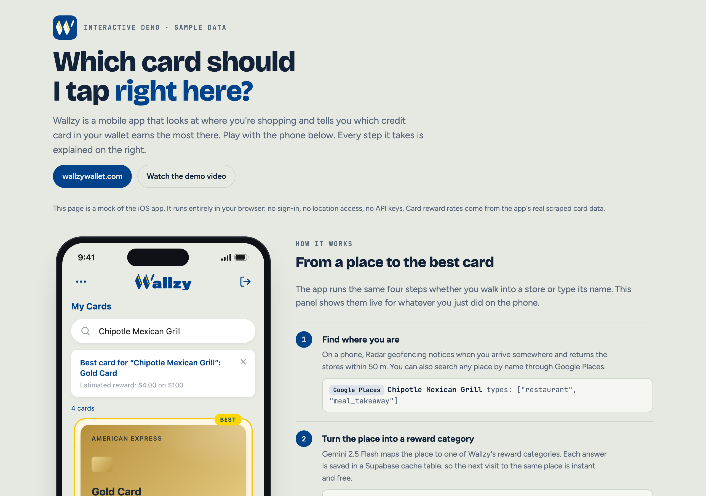
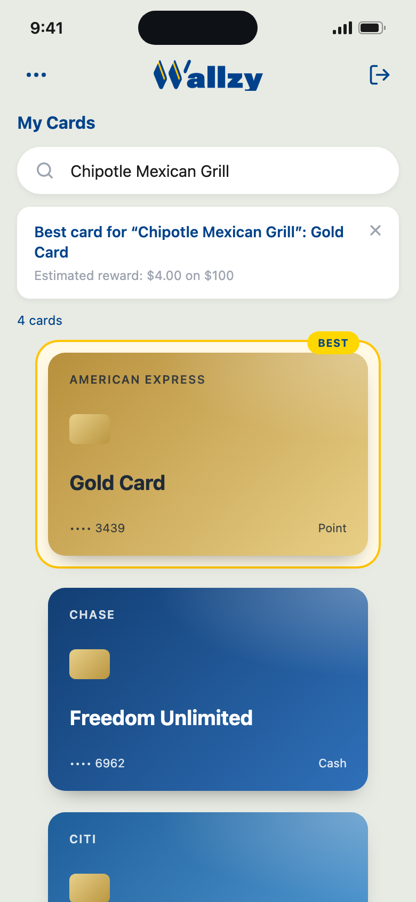
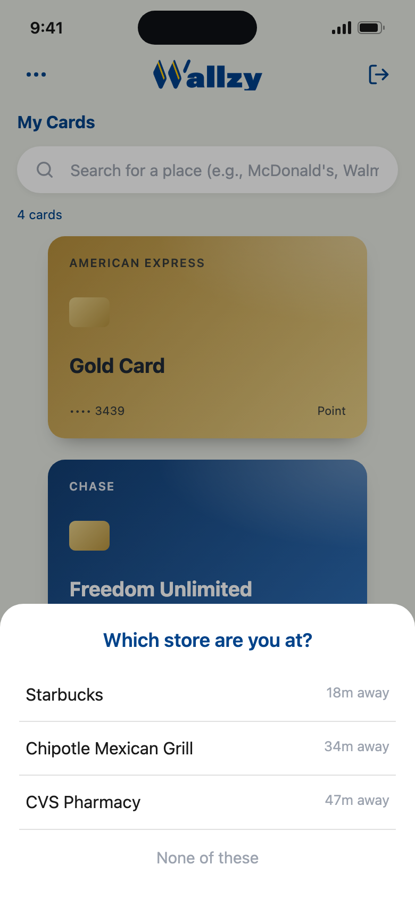
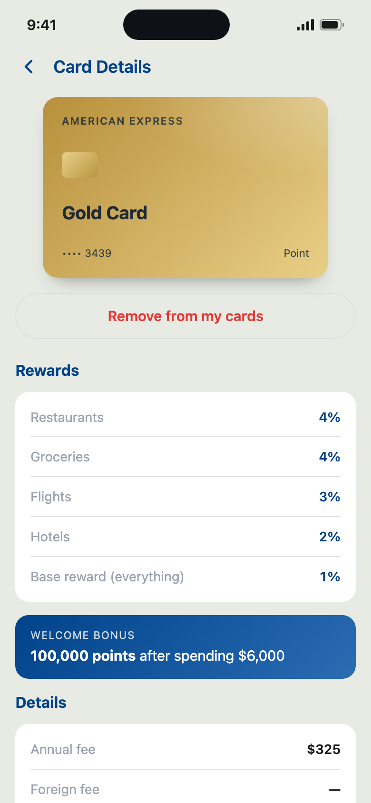
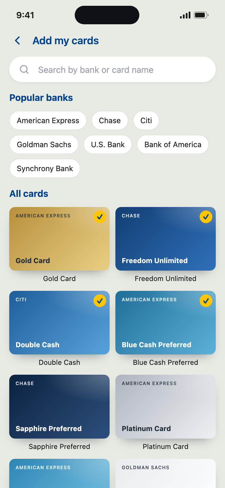
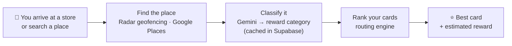

<p align="center">
  
</p>

<p align="center">
  <b>Stop guessing, start earning.</b><br>
  A mobile app that tells you which credit card in your wallet earns the most rewards at the place you're standing in.
</p>

<p align="center">
  <a href="https://www.wallzywallet.com"><b>🌐 wallzywallet.com</b></a> &nbsp;·&nbsp;
  <a href="https://drive.google.com/file/d/1CYrmTBpicqrUI6eGPBNwYxp1mehHDsUm/view?usp=sharing"><b>▶️ Watch the demo video</b></a> &nbsp;·&nbsp;
  <a href="demo/index.html"><b>🕹️ Interactive demo</b></a>
</p>

---

## The problem

Most people carry several credit cards, and each one pays a different reward rate depending on where you shop: 4% at restaurants on one card, 6% at grocery stores on another, 2% on everything with a third. Nobody remembers all of that at the checkout counter, so most purchases go on whichever card is on top.

**Wallzy answers one question at the moment it matters: "Which card should I use here?"** When you walk into a store, the app recognizes where you are, works out what kind of purchase it is, compares every card you own, and puts the winner on top.

## See it in action

<p align="center">
  
</p>

The [interactive demo](demo/index.html) is a clickable mock of the app that runs in any browser. It uses sample data, so you don't need an account, location access or API keys. Pick a location or search a place, and the panel next to the phone shows each step the app takes. To try it, download [`demo/index.html`](demo/index.html) and open it in your browser.

### Screens

| Best card for a place | "Which store are you at?" | Card details | Add your cards |
|:---:|:---:|:---:|:---:|
|  |  |  |  |
| The winning card jumps to the top with a **BEST** badge and the estimated reward on $100. | When you arrive somewhere, Wallzy lists the stores within 50 m so you can confirm where you are. | Every reward category, welcome bonus, annual fee and issuer for a card. | Browse the card catalog by bank and add the cards you own. |

*The screenshots are taken from the interactive demo, which mirrors the real app's layout, colors and copy.*

## How it works



1. **Find where you are.** [Radar](https://radar.com) geofencing detects when you arrive somewhere and returns the stores within 50 m. You can also search any place by name through the Google Places API.
2. **Turn the place into a reward category.** Google Maps calls a place a `restaurant` or a `gas_station`, but card issuers use their own categories ("dining", "gas & EV"). Gemini 2.5 Flash maps the place to one of Wallzy's reward categories. The answer is cached in Supabase, so the next lookup of the same place is instant and makes no AI call.
3. **Rank the cards in your wallet.** For each card you own, the routing engine looks up the rate for that category. If the card has none, it tries a parent category (a restaurant also counts as dining), then the card's base rate. Sign-up bonuses and rates you set yourself take priority. Ties are all shown as best.
4. **Show the answer.** The best card moves to the top of your wallet with the estimated reward on a $100 purchase.

The card data comes from a separate **Python scraper**. It visits each issuer's card page with Playwright, has Gemini pull out the reward structure as JSON, and uploads the result to Supabase.

## Tech stack

| Layer | Technology |
|---|---|
| Mobile app | React Native 0.81, Expo SDK 54, Expo Router, TypeScript |
| Backend | Supabase (Postgres, Auth with email, Google and Apple sign-in) |
| Location | Radar SDK (geofencing, nearby places), Google Places API |
| AI | Gemini 2.5 Flash (place → reward category, card-page → structured data) |
| Data pipeline | Python, Playwright, BeautifulSoup |
| State and data | TanStack Query, Zustand |
| Build and release | EAS Build (iOS / Android) |

## Engineering highlights

- **The AI cost scales with places, not users.** Every place category Gemini returns is stored in a Supabase cache table keyed by the place ID. Popular places are classified once and then served from the cache.
- **Per-user data isolation.** Card recommendations used to come from a SQL function that joined on card ID only. That let one user's custom reward settings leak into another user's results. The routing engine was moved into TypeScript, where every per-user query is explicitly filtered by user ID ([`routingService.ts`](services/RoutingEngine/routingService.ts)).
- **A scraper that resumes after crashes.** The scraper saves after every card and retries only the cards that failed, so a long run over dozens of issuer websites can be stopped and restarted safely.
- **The app runs without the native module.** Radar is loaded defensively, so the app still runs in Expo Go during development, where the native SDK isn't available.

## Project structure

```
app/                 Screens (Expo Router)
  (auth)/            Sign-in, sign-up, verification, password reset
  (app)/             Dashboard, card details, add cards, feedback
  _layout.tsx        Providers, auth gating, location → best-card pipeline
services/
  RoutingEngine/     chooseBestCard(): ranks your cards for a category
  radar/             Nearby places + place → category (Radar)
  GooglePlaces/      Search, autocomplete + place → category (Google)
  cardSupabase/      Card and user-card data access
  Scraper/           Python card-data scraper and uploader
contexts/            Auth and selected-place state
lib/                 Supabase client, OAuth helpers
demo/                Self-contained interactive web demo (sample data)
```

## Running the app locally

**Prerequisites:** Node.js 18+, the [Expo Go](https://expo.dev/go) app or an iOS/Android simulator, and Python 3.10+ if you want to run the scraper.

```bash
git clone https://github.com/wallzywallet-admin/Wallzy-MVP.git
cd Wallzy-MVP
npm install
cp .env.example .env   # then fill in your keys (see below)
npm start
```

In the Expo terminal, press `i` for the iOS Simulator or `a` for the Android emulator, or scan the QR code with Expo Go. Location features need a development build (`npm run ios` / `npm run android`), because Radar is a native module.

<details>
<summary><b>Environment variables</b></summary>

| Variable | Where to get it |
|---|---|
| `EXPO_PUBLIC_SUPABASE_URL`, `EXPO_PUBLIC_SUPABASE_ANON_KEY` | [Supabase](https://supabase.com) → your project → Settings → API |
| `EXPO_PUBLIC_GOOGLE_IOS_CLIENT_ID`, `EXPO_PUBLIC_GOOGLE_WEB_CLIENT_ID` | [Google Cloud Console](https://console.cloud.google.com) → APIs → Credentials |
| `EXPO_PUBLIC_GOOGLE_PLACES_KEY` | Google Cloud Console, with the Places API enabled |
| `EXPO_PUBLIC_RADAR_KEY` | [Radar](https://radar.com) → your project → API Keys |
| `EXPO_PUBLIC_GEMINI_API_KEY` | [Google AI Studio](https://aistudio.google.com/apikey) |
| `APPLE_TEAM_ID`, `APPLE_KEY_ID`, `APPLE_CLIENT_ID`, `APPLE_PRIVATE_KEY` | Apple Developer → Membership / Keys (Apple Sign-In) |

</details>

<details>
<summary><b>Running the card scraper (optional)</b></summary>

```bash
cd services/Scraper
pip install playwright beautifulsoup4 google-genai python-dotenv supabase
python -m playwright install firefox
python main.py          # scrapes the cards in resource.json → card.json (resumes if interrupted)
```

See [`services/Scraper/README.md`](services/Scraper/README.md) for the output schema.

</details>

<details>
<summary><b>Troubleshooting</b></summary>

- **App not loading on your phone?** Put the phone and computer on the same Wi-Fi, or use tunnel mode: `npm start -- --tunnel`.
- **Dependency issues?** `rm -rf node_modules && npm install`
- **Stale bundle?** `npx expo start --clear`
- **Gemini quota errors in the scraper?** Use a key from a project on a paid tier in Google AI Studio.

</details>
